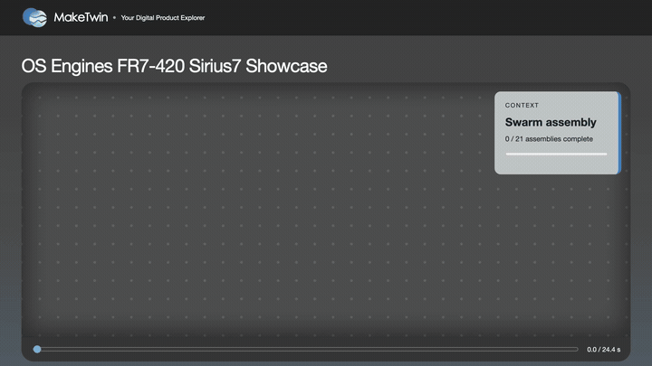

<div align="center">

<h4 align="center"><br /></h4>

**Your digital product explorer.**

[](https://github.com/MicrochainToken/MakeTwin/actions/workflows/ci.yml) [](CHANGELOG.md) [](https://www.blender.org) [](requirements.txt) [](https://threejs.org)

</div>

MakeTwin turns product photos and manuals into explorable digital twins, built with your own coding agent. **Version 1.0 focuses on mechanical products**; support for other kinds of product is planned for later releases.

<p align="center"></p>

## What you get

- **Named, reusable parts**: a Blender model and GLB where every part has an ID, a function, and relationships to its neighbours.
- **A browser viewer**: take apart, isolate, see through, and cut sections of the model, with a guided tour.
- **Honest evidence labels**: details are tagged observed, inferred, or illustrative, and checks report what passed and what did not.

The skill's install ID is `mechanical-explorer-test`, kept for compatibility. Models can contain labeled approximations; review the delivered findings before treating a model as accurate.

## Setup

| Tool | When you need it |
| --- | --- |
| Blender 4.2+ | Geometry, animation, rendering, and GLB export. Locally tested with Blender 5.2. |
| Python 3.10+ | Setup, image preparation, metadata checks, and the local viewer server. |
| Pillow | Preparing product photos; included in `requirements.txt`. |
| Poppler | Reading PDF manuals: `pdftoppm`, `pdftotext`, and `pdfinfo`. |
| A coding agent with file and shell access | Reading the skill and authoring the model. It uses your own model access. |

From this folder, on macOS/Linux:

```sh
python3 -m venv .venv
source .venv/bin/activate
python3 -m pip install -r requirements.txt
python3 scripts/doctor.py
```

<details>
<summary>Windows setup</summary>

Use PowerShell from this folder. These commands do not require activating the environment:

```powershell
py -3 -m venv .venv
.\.venv\Scripts\python.exe -m pip install -r requirements.txt
.\.venv\Scripts\python.exe scripts\doctor.py
```

Install Poppler separately if you supply a PDF. Add Blender to PATH or set `BLENDER` to its executable. Shell-based build/test commands also need Bash, such as Git Bash. Native Windows execution has not been validated locally.

</details>

<details>
<summary>Blender is installed but the check cannot find it</summary>

On macOS:

```sh
export BLENDER="/Applications/Blender.app/Contents/MacOS/Blender"
python3 scripts/doctor.py
```

On Linux, use the path to your Blender executable. On Windows PowerShell, use `$env:BLENDER = "C:\path\to\blender.exe"`.

</details>

Install Poppler with your operating system’s package manager; on macOS, `brew install poppler`. `doctor.py` reports the tools it finds and makes no model/provider calls. Node.js 22+ is needed for the viewer regression tests. Neither is needed to open a finished viewer.

## Make your first model

Use a separate product folder for inputs and generated files. Supply photos from several angles, close-ups of important interfaces, and any available manual or dimensions. You can start with photos alone, or ask the agent for a product-specific photo guide first.

Open this folder in your coding agent and ask:

```text
Read SKILL.md. Model the product shown in /path/to/product/photos.
Use /path/to/product/manual.pdf if available, and save the result in
/path/to/product/output.

Create separate named parts, a reusable Blender model and GLB, and parts.json
with functions, assemblies, interfaces, evidence, and supported movement.
Keep the exterior recognizable. Use meaningful detail, label uncertain internals,
and include a short How it works demo in the supplied viewer.
Run the checks and include remaining findings in REVIEW.md.
```

Use any coding agent with file and shell access. MakeTwin makes no model or provider calls of its own; usage is whatever your agent bills.

## Open and share the output

In the generated output folder:

```sh
python3 -m http.server 8000 --bind 127.0.0.1
```

Open [http://127.0.0.1:8000](http://127.0.0.1:8000). Use **Play full tour**, **Take apart**, **Isolate**, **Transparent context**, and the separation slider. The section preview is an uncapped visual cut.

Share the complete output folder, including `model.glb`, its manifest, `parts.json`, `explorer.json`, and all viewer assets. Opening only the HTML file or sharing only the GLB will not provide the complete viewer experience. The `.blend` and `.glb` can also be opened independently in compatible desktop tools.

| Output | Contents |
| --- | --- |
| `model.blend` | Editable parts, physical hierarchy, and pivots. |
| `model.glb` + `model.manifest.json` | Portable geometry, named animation clips, and export metadata. |
| `parts.json` | Part IDs, functions, assemblies, attachments, interfaces, evidence, and movement. |
| `explorer.json` | Staged display offsets and selection groups. |
| `build.py` | Rebuildable scene source; retain referenced helpers or companion source files. |
| `REVIEW.md`, checks, and renders | Assumptions, completed checks, and remaining problems. |

## Metadata other tools can use

IDs match the exported parts. A record can explain that a filter removes debris, that a screw fastens a particular cover, or that a shaft rotates about a declared axis. Unsupported movement stays unknown.

See the [part metadata contract](reference/reusable-parts.md) for the schema and [take-apart contract](reference/take-apart.md) for display groups. These files let other agents address the model without depending on this viewer.

## Detail and accuracy

There is no component-count target. Model detail should explain a function or a visible interface. Hidden construction can be inferred when useful, with explicit evidence labels. Unknown specifications and performance numbers must stay unknown.

An exploded display is an inspection arrangement, not automatically a physically valid service procedure. Passing metadata validation establishes ID/schema consistency; it does not certify the model’s geometry or function. The workflow preserves failed checks and partial status. See [validation notes](docs/VALIDATION.md) for implementation evidence and known limitations.

## Developer tools

<details>
<summary>Check a generated model and its metadata</summary>

Run from this skill folder, replacing the output path:

```sh
python3 scripts/validate_parts.py --manifest /path/to/output/model.manifest.json --parts /path/to/output/parts.json --out /path/to/output/parts-audit.json
python3 scripts/audit_explosion.py --manifest /path/to/output/model.manifest.json --explorer /path/to/output/explorer.json --minimum 1 --out /path/to/output/explosion-audit.json
python3 scripts/verify_delivery.py /path/to/output --report /path/to/output/delivery-report.json
```

The Blender geometry checker and exporters are documented in [SKILL.md](SKILL.md). Normal export preserves joint hierarchy. `--fast-transform-export` is available for dense rigid-transform animations; it flattens GLB mesh nodes while the Blender source and metadata retain assembly meaning. It does not export animated mesh deformation.

</details>

<details>
<summary>Run regressions or package the skill</summary>

Choose a new output directory/file:

```sh
bash tests/run_tests.sh ./test-output
python3 scripts/package_showcase.py --out ./maketwin-1.0.0.zip
```

These commands make no model calls. The suite includes Blender fixtures, export guards, metadata checks, and viewer tests. The ZIP includes the complete reusable skill and viewer assets.

</details>

Retain the bundled [Three.js license](templates/viewer/THREE-LICENSE.txt) and vendor source records when distributing the viewer. Runtime origins and attribution are recorded in [PROVENANCE.md](PROVENANCE.md).

## Repository layout

| Path | Purpose |
| --- | --- |
| `SKILL.md` | The agent skill: workflow instructions. |
| `reference/` | Modeling, mechanism, take-apart, and metadata guides. |
| `scripts/` | Blender build/check/export tools, validators, and packaging tools. |
| `templates/viewer/` | The browser viewer and a bundled sample model. |
| `examples/` | Small reference builds. |
| `tests/` | Regression suites; run `bash tests/run_tests.sh`. |
| `docs/VALIDATION.md` | Validation evidence and known limitations. |
| `assets/` | Logo and README images. |

## Versioning and changes

Releases follow [Semantic Versioning](https://semver.org); the current version is in [`VERSION`](VERSION) and changes are listed in the [changelog](CHANGELOG.md). See [CONTRIBUTING.md](CONTRIBUTING.md) to propose changes.

The project's own license has not been decided yet. The bundled Three.js viewer libraries keep their own license (see above).
